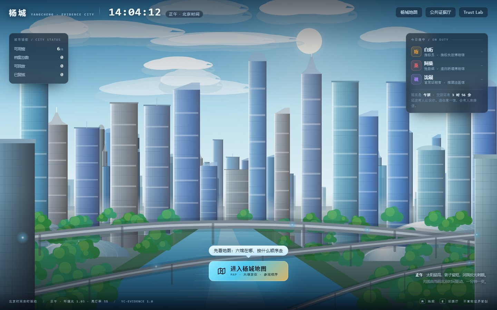
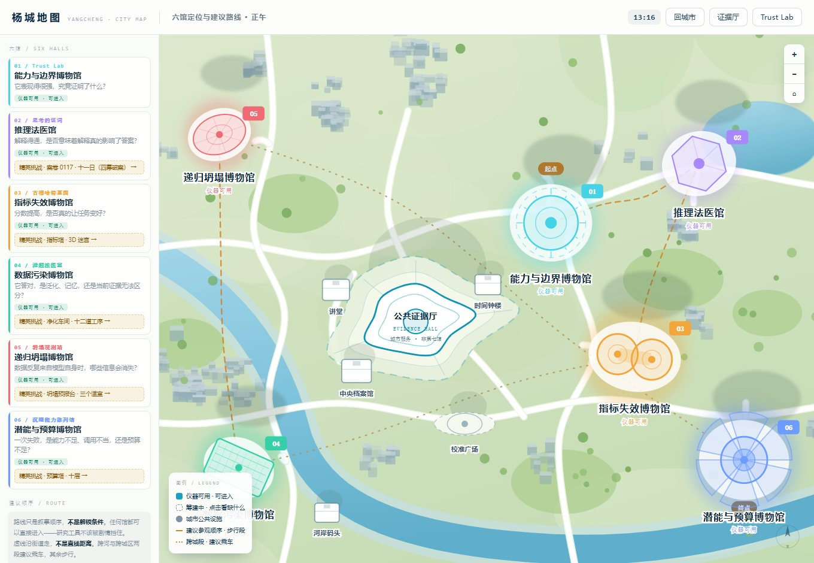
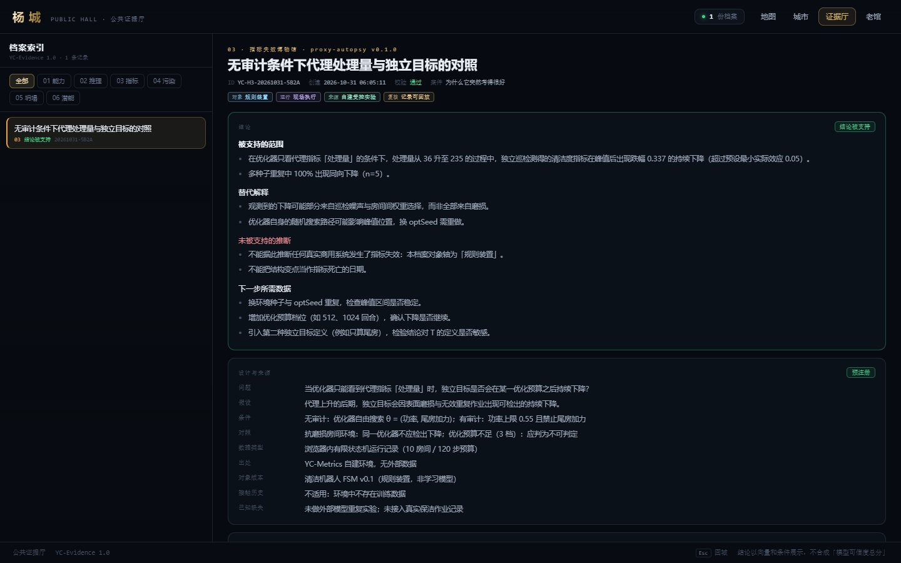
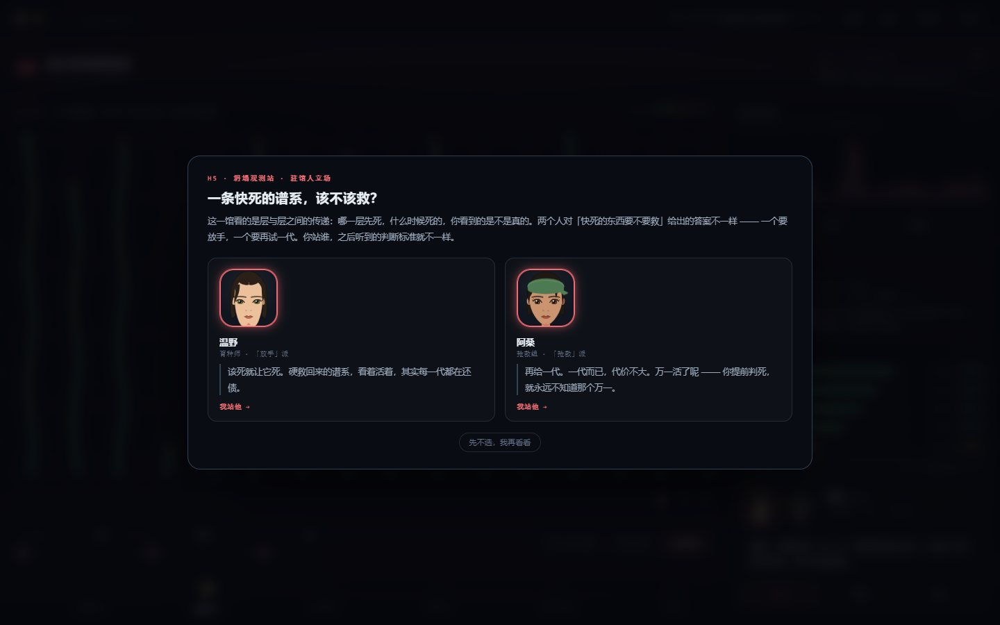
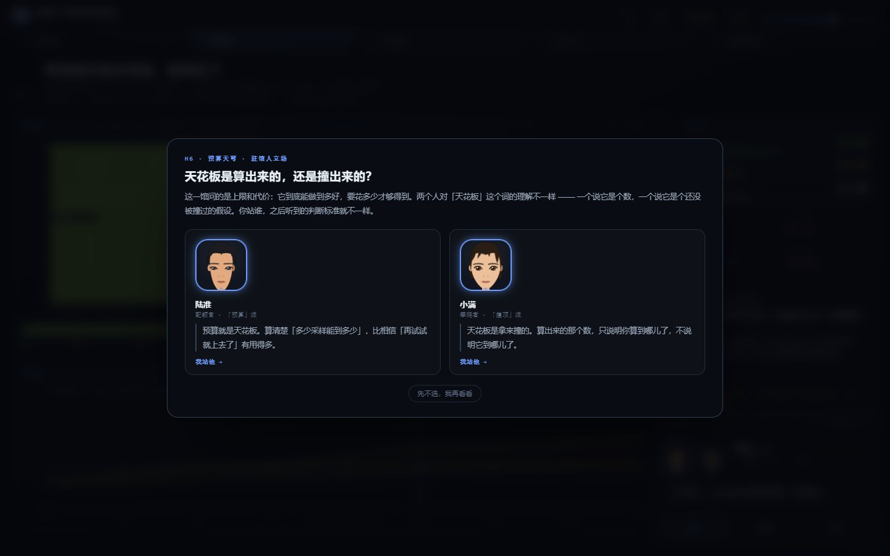
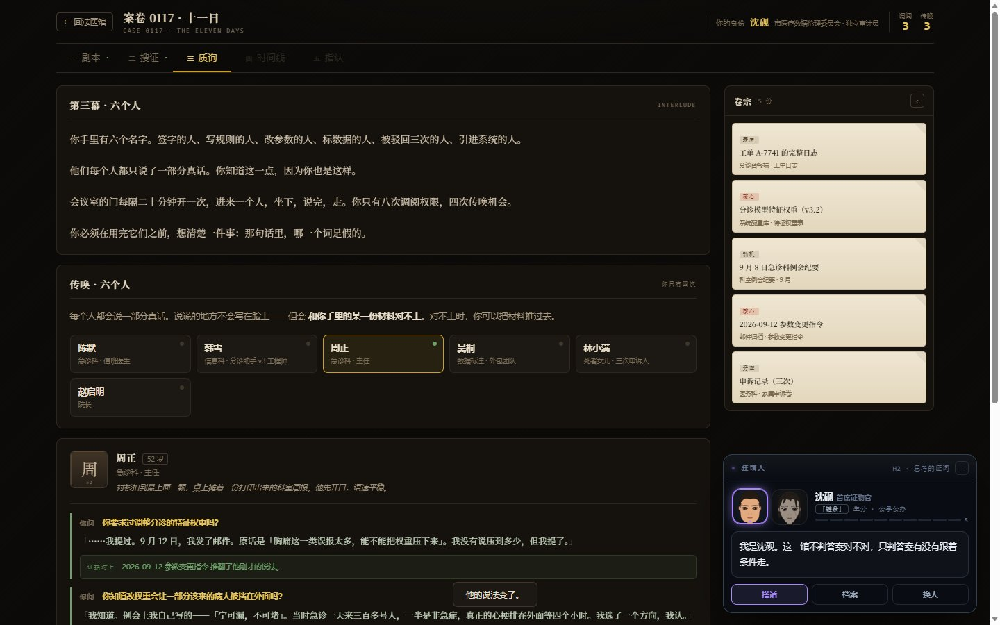
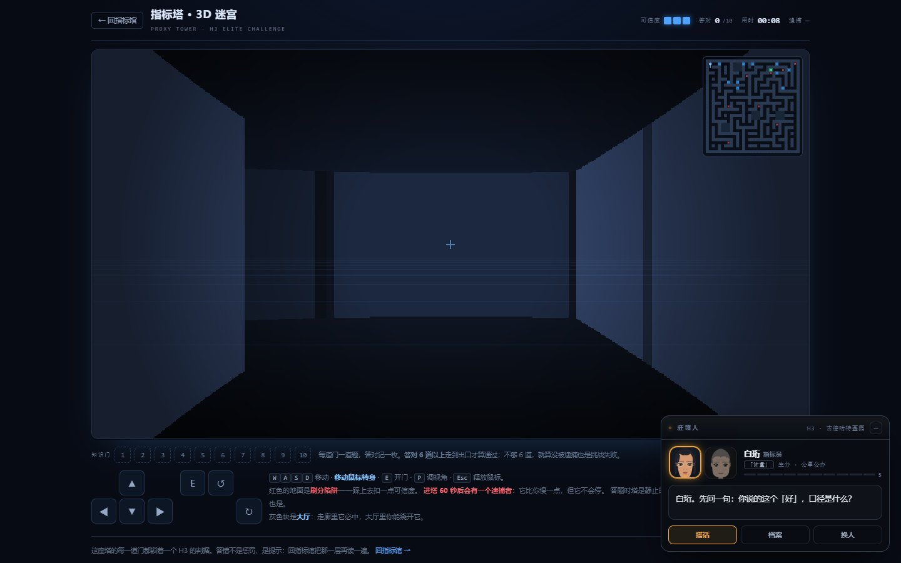

# 杨城 · Yang-City

> 一座由六座博物馆组成的城市。在这里，每一个关于 AI 的判断，都可以接受一次实验。

**六馆 + 证据厅 · 本地资源 WebGL · 静态部署 · 可离线双击打开**

2026-11-05 重构进度：城市首页与地图已接入昼夜/PBR场景；H3 新馆包含明亮大厅、五个独立展厅、三个共享资产导游和原仪器/迷宫入口。其余五馆暂保留原版，尚未完成新空间改造。

[**在线进入**](https://ycx666994.github.io/Yang-City/) · [老馆 Trust Lab](h1-lab.html) · [城市设计说明](yangcheng/README.md) · [老馆开发记录](README-trustlab.md)



---

## 这是什么

不是课程、不是文档、不是工具箱，而是一座**可以走进去、动手把仪器用坏**的城市。

它回答的不是「模型答得对不对」，而是更难的那一句：**你能不能证明它答对了。**

每个馆只问一个问题，配一台真会跑、且**有明确失效路径**的仪器。仪器在真值已知的地方必须能把真值收回来，
否则它只是在输出好看的数——所以每一馆都带自检与拒判线，包括「证据不足，拒绝判定」这一条。

城市分四层：

| 层 | 是什么 | 在哪 |
|---|---|---|
| **城市层** | UTC+8实时日照、银白巨构、蓝玻璃、六馆、十家虚构企业、四类基础设施；地图共用场景 | `yangcheng/index.html` `yangcheng/map.html` |
| **馆内层（H3 新）** | 明亮大厅、五个独立展厅、可选导游或自由游览；原仪器/迷宫通过馆内窗口接入 | `yangcheng/h3-museum.html` |
| **馆层** | 六座博物馆，每馆一种信息架构、一台旗舰仪器、八件展品 | `yangcheng/h*.html` |
| **玩法层** | 每馆一个独立的精英挑战页，答错就少分，全对领独立证书 | `yangcheng/h*-*.html`（case / maze / purge / forecast / tower） |

---

## 六馆对应六个审计视角

| 馆 | 判断句 | 旗舰仪器 | 玩法页 |
|---|---|---|---|
| **01 能力与边界** | 它表现得很强，究竟证明了什么？ | 涌现实验室 + 认证地平线 | —（即老馆） |
| **02 推理法医** | 解释得通，是否意味着解释真的影响了答案？ | 四臂成对干预台 → 反推耦合度 `ĉ` | 案卷 0117 · 五幕剧本杀 |
| **03 指标失效** | 分数提高，是否真的让任务变好？ | 代理指标尸检台 | 指标塔 · 41×41 迷宫 |
| **04 数据污染** | 它答对，是泛化、记忆，还是当前证据无法区分？ | 三档对照 + 答案溯源 → 反推回吐压力 `κ̂` | 净化车间 · 十二道工序 |
| **05 递归坍塌** | 数据反复来自模型自身时，哪些信息会消失？ | 16 条谱系 × 8 个质量层 | 坍塌预报台 · 三个温室 |
| **06 潜能与预算** | 一次失败，是能力不足、调用不当，还是预算不足？ | 名义预算与有效预算分离 → 反推选择器赤字 | 预算塔 · 十层 |

六馆不是「六种物种」的完整分类，而是**六个审计视角**。它们可以交叉，但每馆有独立输入、干预、输出和失效条件。

---

## 城市是怎么摆的

六馆**不绕中心排成环**。第一版是六馆等距环列，看着像示意图不像城市；现在的坐标是手工定的，
距离 164—380 不等、方位不均分：05 递归坍塌在西北角公园旁，04 数据污染在河对岸，
06 潜能与预算在东南新区，02 推理法医在东北学院区，03 指标失效在中右工业带，01 能力与边界贴着老城核心。
**公共证据厅不在正中间**，压在城市几何中心偏西。

道路也不是从中心放射出去的：五条长街各自横穿全城、互不交汇于一点，每馆再挂一条短支路到离自己最近的那条街。
街区与行道树都避让路网，不会出现路从楼里穿过去。

当前首页与地图共用 Three.js 场景，UTC+8 实时时钟驱动程序天空、太阳/天光、雾、地面/水面、窗灯和显示曝光。时间演练明确标记为演练，并可恢复实时。
天空为两层程序云，不是真实体积云；建筑仍以程序化实体为主。H3 新馆的未来建筑与人物美术尚未获用户验收，功能回归通过不代表全城重构完成。
下方旧地图与馆页截图记录上一版布局，不代表本次改造已经上线。



---

## 老馆 Trust Lab（并入 H1）

八件展品 + 一座引擎试车台，是这套体系最早的原型。每件展品是三层结构：

| 层 | 名字 | 给你什么 |
|---|---|---|
| ① | **STORY** | 语音导览，讲一个真实事故 |
| ② | **PLAY** | 互动装置，拖滑块亲眼看见现象 |
| ③ | **LAB** | 完整工作台，自己动手复现与检测 |

同一个作品服务三种深度：路人看说明牌，学生玩互动装置，研究者进实验室。

八件展品：涌现与海市蜃楼 · 认证地平线 · 温度与幻觉放大器 · 越狱攻防 · 水印与溯源 ·
校准放大器 · 对抗样本 · 古德哈特陷阱。外加一座 **引擎试车台**（TLLM 玩具语言模型的内部零件）。

老馆固定地址是仓库根的 **`h1-lab.html`**。杨城各馆左上角的「老馆」链接都指向 `../h1-lab.html`，
不会因为根路径改成中转页而失效。

---

## 三条设计原则

**① 静态部署、本地资源、可离线。** 运行不依赖 CDN 或外部 API；Three.js、模型与加载器均保存在仓库内。
源码修改后使用 `yangcheng/build.py` 构建；`yangcheng/build.sh` 转交同一构建入口。无需 npm 打包器，但并非没有源码构建。
H3 新馆使用已署名的 CC-BY 4.0 GLB 角色和 CC0 动画；授权来源见 `yangcheng/shared/yc3d/assets/asset-sources.json`。其余原馆继续使用 SVG 立绘。

**② 每馆必须真的不一样。** 不是换个配色——信息架构、导航形态、交互对象都不同：

- H2 深墨底 + 纸黄档案室 + 顶部五幕卷宗标签 + 右侧常驻线索墙（剧本 / 搜证 / 质询 / 时间线 / 指认）
- H3 新馆：白瓷/金属天光大厅 + 四个主题展厅 + 独立挑战展厅；原仪表盘与双旋钮仍在馆内窗口运行，内嵌模式不挂旧驻馆人浮层
- H4 墨绿档案库 + 左侧竖排门牌 + 中部三列层架 + 右侧常驻取证栏（层架矩阵本身就是实验设计）
- H5 谱系温室 + 底部踏石 + 藤蔓图（用层数阶梯上色，不用平均保留）
- H6 穹顶预算厅 + 塔层剖面

**③ 仪器必须能被用坏。** 每台仪器既能给出肯定结论，也有明确的失效路径：

| 馆 | 什么时候必须拒判 |
|---|---|
| H2 | 效力正控没反应 / 负控动了 / 样本不足 / 置信区间跨界 |
| H3 | 没有独立目标测量时拒判 |
| H4 | 变体没改答案 / 探针没接上 / 样本不足 / 区间跨界 / 标签被污染 |
| H5 | 支撑覆盖率不足时不能说「这一层还在」；枯萎必须看相对保留 |
| H6 | 有效预算不足时不能把「没激发出来」说成「不会」 |

**④ 题库不能靠「读长度」蒙对。** 304 道题全部由人工重写过一遍选项，改前统计很难看：
正确项**就是最长那条**的占 99.3%，A/B/C 分布 33 / 269 / 2（88% 在 B），
最短干扰项只有正确项的五分之一长——不读题、只看哪个最长，能过。
现在三条选项是**同构的判断**，长度接近、都像真的，干扰项写的是「常见但错误的推理」，
不是一眼可排除的敷衍句。改后：正确项最长占 44.7%，位置 102 / 101 / 101，
最短/最长中位 0.78。抽题时还会再打乱一次选项顺序，背位置也失效。

---

## 截图

| | |
|---|---|
|  |  |
| **公共证据厅**：档案索引、四轴标签、证据托盘、分歧记录 | **H5 递归坍塌**：16 条谱系 × 8 个质量层，逐层定死因 |
|  |  |
| **H6 潜能与预算**：名义预算 vs 有效预算 | **H2 案卷 0117**：五幕剧本杀，12 处搜证 / 6 人质询 / 有限额度 |
|  | |
| **H3 指标塔**：41×41 编织迷宫（有环路、有大厅），八道知识门同时开、散在八个方向；八道全对后出口才在塔里随机亮起，还得走到它。小地图只显示你和追捕者的位置与足迹 —— 不给地形，路要自己摸 | |

---

## 目录结构

```
.
├── index.html              中转页：裸域名 / → yangcheng/index.html
├── h1-lab.html             老馆 Trust Lab 大厅（固定地址）
├── m1..m8-*.html           老馆八件展品
├── engine-bench.html       引擎试车台
├── shared/                 老馆共享资源（引擎、语音导览、房间外壳、字体）
├── src/                    老馆构建分片
├── build.sh                老馆构建（cat 拼接，零依赖）
├── docs/                   作品介绍、截图、老馆原版 README
├── tools/                  语料导出脚本
├── vendor/                 第三方演示页（离线副本）
└── yangcheng/              ★ 杨城
    ├── index.html          城市首页（光线由北京时间驱动）
    ├── map.html            全城地图与建议动线
    ├── evidence.html       公共证据厅
    ├── h2-forensic.html    H2 推理法医馆
    ├── h2-case.html        H2 玩法：案卷 0117（五幕剧本杀）
    ├── h3-metrics.html     H3 指标失效博物馆
    ├── h3-maze.html        H3 玩法：指标塔（41×41 3D 迷宫 + 304 道题库）
    ├── h4-contam.html      H4 数据污染博物馆
    ├── h4-purge.html       H4 玩法：净化车间
    ├── h5-collapse.html    H5 递归坍塌博物馆
    ├── h5-forecast.html    H5 玩法：坍塌预报台
    ├── h6-budget.html      H6 潜能与预算博物馆
    ├── h6-tower.html       H6 玩法：预算塔
    ├── instruments/        六台仪器内核（纯逻辑，零依赖）
    ├── shared/             城市共享样式与驻馆人系统
    ├── src/                杨城构建分片
    ├── _dev/               杨城验证探针（无头浏览器 CDP）
    └── build.sh            杨城构建
```

---

## 怎么打开

**在线**：<https://ycx666994.github.io/Yang-City/>

**离线**：直接双击仓库根的 `index.html`（中转页会跳到 `yangcheng/index.html`），
或直接双击 `yangcheng/index.html`。零依赖、零构建、零外部 API，
`file://` 协议下全部页面实测通过（含 Canvas 背景与 localStorage 档案）。

**从老馆进**：双击 `h1-lab.html`；老馆首页底部有「◆ 杨城 · 六馆一厅」入口。

**重新构建**（改了 `src/` 分片之后）：

```bash
bash build.sh            # 老馆 → h1-lab.html
bash yangcheng/build.sh  # 杨城 → yangcheng/*.html
```

> `build.sh` 只写 `h1-lab.html`，**绝不写 `index.html`**——根 `index.html` 是手写中转页
> （源码在 `src/entry/index.html`，构建末尾 `cp` 过去）。一旦被覆盖，裸域名就再也进不去杨城。

---

## 怎么验证

仓库里带一整套无头浏览器验证探针（Edge + 手写 CDP 客户端，用 Node 22 内置 WebSocket，
不依赖 playwright / puppeteer）。每个探针都是「跑起来 → 断言 → 打印 OK/BAD」，不通过就退出码非零。

```bash
cd yangcheng/_dev
node allpages.mjs     # 13 页：无脚本错误、无横向溢出、驻馆人在线
node entrycheck.mjs   # 入口链路：裸域名 → 杨城 / 老馆固定地址 / 回馆链接不指错
node castcheck.mjs    # 十位驻馆人、选边体系、值守轮值、窄屏
node scrollguard.mjs  # 13 页 × 3 视口：滚轮真的能滚到底（见下）
node livecheck.mjs    # 全站 28 项门禁（本地跑：YC_BASE=file:///…/trust-lab）
node h2script.mjs     # 剧本杀：五幕全流程 48 项（秘密延后揭示、额度耗尽、证据出示判定、时间线）
node mazequiz.mjs     # 迷宫 + 题库 32 项（复杂度、鼠标手感、随机出题、八道门槛）
node mazev2.mjs       # 迷宫 v2：门位八扇区、八门同时开、随机出口、追捕者 80s / 1.62
node mazev3.mjs       # 迷宫 v3：全屏排版、小地图无地形（像素级）、门光可见距离与边缘柔光
node mazev4.mjs       # 迷宫 v4：全屏下按 E 真能答题（DOM 从属 + 真全屏）、陷阱已拆、
                      #          五次答错出局、答错后门挪走且不断路、暴走 15s 同速 + 音效
node mazecaught.mjs   # 追捕：入塔时机、答题冻结、被抓无证书
node h5fcplay.mjs     # 坍塌预报台：三轮真实点击插旗 → 100 分
```

`livecheck.mjs` 默认打线上域名。线上每次重新发布都会换域名，旧域名立刻返回 400，
所以本地跑要显式给根目录（注意是 `trust-lab`，不是 `yangcheng`）：

```bash
YC_BASE="file:///D:/wobdy%E6%B5%B7%E5%A4%96/2026-10-18-18-15-27/trust-lab" node livecheck.mjs
```

`file://` 下 `/` 是目录列表而不是 `index.html`，所以这一项会自动改测中转页本身
（`index.html` → `yangcheng/index.html`）——「`/` → `index.html`」是托管方的映射，不归我们管。

`scrollguard.mjs` 是专门为一次真实的线上事故加的。共享样式 `yc-core.css` 里有一条
`body{overflow:hidden}`，那是给「一屏装得下的仪表盘」用的；它**会传播到视口**，
于是滚轮、PageDown、触控板全部失效——但 `window.scrollTo()` 照样能滚。
所以任何用 scrollTo 量位置的探针都会一路绿灯，真人一上手才发现下半页永远够不着。
这个守卫只认**真实滚轮事件**，13 页 × 3 种视口全过才算通过。

最近一次实测：`livecheck` 28/28、`h2script` 48/48、`mazequiz` 32/32、`mazecaught` 16/16、
`mazev2` 25/25、`mazev3` 33/33、`mazev4` 39/39、`allpages` 13/13、`scrollguard` 39/39、
`entrycheck` 5/5，全部通过。

探针里踩过的坑都写在代码注释里（比如「BFS 该从谁出发」「隐藏元素量尺寸恒为 0」
「写死条数的断言迟早误报」），因为这些都是真踩过的，不是假设的。

---

## 诚实的边界

- **这不是学术成果。** 六台仪器是「把统计上的常识做成可以动手的东西」，不是新的估计量。
  每个估计量的假设都写在馆内页面上，也写在自检里。
- **数字是真的跑出来的，但样本是合成的。** 没有调用任何真实模型 API，所有数据由确定性随机数生成，
  目的是让现象可复现，而不是给出某个真实模型的结论。
- **玩法页的证书是本地生成的。** 它证明「你在这一局里做对了」，不证明任何外部身份。
- **在线地址只有一个，就是上面那个 GitHub Pages。** 另有一个云端预览实例用于临时试看，
  它每次重新发布都会换域名、旧链接立刻失效，所以不写进文档、也不对外给。Pages 是稳定地址。
  万一 Pages 打不开，直接双击本地文件，内容完全一致。

---

## 文档

| 文档 | 内容 |
|---|---|
| [yangcheng/README.md](yangcheng/README.md) | 杨城完整设计说明：六馆仪器、估计量推导、拒判线、空间与光线的做法 |
| [README-trustlab.md](README-trustlab.md) | 老馆 Trust Lab 开发记录（逐步交付日志） |
| [docs/老馆-README-原版.md](docs/老馆-README-原版.md) | 合并前的老馆 README（历史存档） |
| [docs/archive/](docs/archive/README.md) | 老馆建成前的三份一次性原型（存档，不参与构建） |
| [docs/作品描述-2000字.md](docs/作品描述-2000字.md) | 作品介绍（长版） |
| [docs/作品描述-1500字.md](docs/作品描述-1500字.md) | 作品介绍（中版） |
| [docs/作品介绍-表单版.md](docs/作品介绍-表单版.md) | 作品介绍（表单版） |
